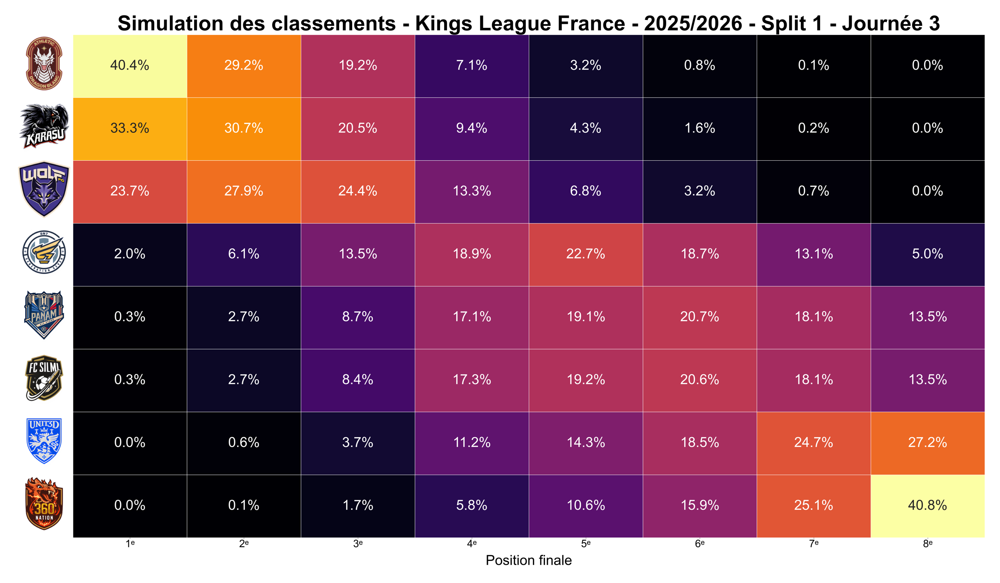

<div align="center">

# Qui va gagner la Kings League France ?

**Kings League France Predictions** · simulateur de classements finaux

À chaque journée, ce projet simule **10 millions de fins de saison** pour estimer
les chances de chaque équipe de terminer à chaque place du classement.

</div>

La [Kings League](https://kingsleague.pro/fr/france) est une ligue de football à 7
aux règles spectaculaires, dont l'édition française réunit huit équipes. Ce projet
répond, journée après journée, à une seule question : qui peut encore finir premier,
et avec quelles chances ?

---

## Dernière prédiction · Saison 2025-2026, Split 1, Journée 3

<div align="center">
  
</div>

**Comment la lire :** chaque ligne est une équipe, chaque colonne une place au
classement final. Une case donne la probabilité que l'équipe termine à cette place.
Plus la case est claire, plus c'est probable.

> Après 3 journées, l'Athletic Dragon Blanc a **40 %** de chances de finir premier,
> Karasu **33 %** et Wolf Pack FC **24 %**.

---

## Comment ça marche

1. **On part du classement actuel** et de la liste des matchs qui restent à jouer.
2. **On simule chaque match restant** des millions de fois, avec des scores tirés au
   hasard selon une loi statistique adaptée au football (la loi de Poisson).
   Comme en Kings League, aucun match ne se termine sur un nul.
3. **On compte où chaque équipe termine** dans chacune des simulations. Si une équipe
   finit première dans 4 millions de saisons simulées sur 10 millions, elle a 40 %
   de chances d'être championne.

---

## Historique des prédictions

| Saison | Journées |
| ------ | -------- |
| 2025-2026 · Split 1 | [J1](result/2025-2026/split_1/J1.png) · [J2](result/2025-2026/split_1/J2.png) · [J3](result/2025-2026/split_1/J3.png) |
| 2024-2025 · Split 1 | [J3](result/2024-2025/split_1/J3.png) · [J4](result/2024-2025/split_1/J4.png) · [J5](result/2024-2025/split_1/J5.png) · [J6](result/2024-2025/split_1/J6.png) |

Les probabilités détaillées de chaque journée sont aussi disponibles en CSV dans
le dossier [`result/`](result/README.md).

---

## Pour les développeurs

<details>
<summary><b>Installation</b></summary>

<br>

Nécessite [uv](https://docs.astral.sh/uv/), qui installe aussi Python 3.14 si besoin.

```bash
git clone https://github.com/Laidwin/Kings_League_France_Predictions.git
cd Kings_League_France_Predictions
uv sync
```

</details>

<details>
<summary><b>Utilisation</b></summary>

<br>

Chaque journée est décrite par un fichier TOML dans `data/`. Le CSV et la heatmap
sont écrits dans `result/<saison>/split_<n>/J<journée>.*`.

```bash
# Lancer la simulation de la journée 3 (saison 2025-2026, split 1)
uv run main.py data/25-26_S1_J3.toml

# Changer de méthode ou de nombre de simulations
uv run main.py data/25-26_S1_J3.toml --method deterministic --simulations 100000

# Générer uniquement le CSV, sans heatmap
uv run main.py data/25-26_S1_J3.toml --no-heatmap
```

Le programme se lance aussi avec `uv run kings-league-predict <fichier>` ou
`uv run python -m kings_league <fichier>`.

</details>

<details>
<summary><b>Méthodes de simulation</b></summary>

<br>

| Méthode | Description |
| ------- | ----------- |
| `monte_carlo_mp` | Monte Carlo avec scores tirés selon une loi de Poisson, en multiprocessing (par défaut) |
| `monte_carlo` | Monte Carlo sur un seul processus |
| `deterministic` | Tirage aléatoire de résultats discrets (victoire ou défaite) |
| `exhaustive` | Énumération de tous les scénarios possibles |
| `exhaustive_mp` | Énumération exhaustive en multiprocessing |

</details>

<details>
<summary><b>Configuration d'une journée</b></summary>

<br>

```toml
[matchday]
name = "Kings League France - 2024-2025 Split 1 Journée 6"
season = "2024-2025"
split = 1
journee = 6

[simulation]
method = "monte_carlo_mp"
nb_simulations = 10_000_000
avg_goals = 4.5            # buts moyens par équipe et par match (4.5 par défaut)

[standings]                # points actuels
"Unit3d" = 9
"Athletic Dragon Blanc" = 9

[strengths]                # force relative de chaque équipe (50 par défaut)
"Unit3d" = 50
"Athletic Dragon Blanc" = 55
```

Les matchs restants se décrivent de deux façons.

**Liste explicite** (en cours de saison) :

```toml
[[remaining_matches]]
home = "FC SILMI"
away = "PANAM ALL STARZ"
```

**Round-robin automatique** (début de saison) : chaque équipe affronte une fois
chacune des autres, et seuls les matchs déjà joués sont retirés. Leurs scores
servent à initialiser la différence de buts.

```toml
[matches]
mode = "round_robin"

[[matches.played]]
home = "FC SILMI"
away = "Wolf Pack FC"
score = [6, 8]
```

</details>

**Stack :** Python, NumPy, pandas, Matplotlib, seaborn.

---

<sub>
Projet de fan non officiel, sans lien avec la Kings League. Les noms et logos des équipes
appartiennent à leurs détenteurs respectifs. Données issues du site officiel de la
<a href="https://kingsleague.pro/fr/france">Kings League France</a>.
</sub>

<br><br>

<sub>Licence MIT, voir <a href="LICENSE">LICENSE</a>.</sub>
